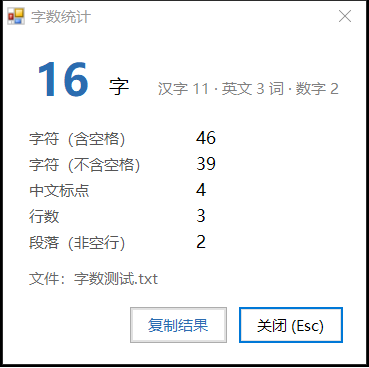

# Notepad Word Count · 记事本字数统计

Windows 右键菜单里的字数统计工具。右键任意文本文件 →「统计字数」→ 弹窗报数 → 关掉即退出。



**12 KB · 无后台进程 · 无需安装运行时**

## 特性

- **右键直接用**：`.txt` `.md` `.log`、代码、配置、字幕等 58 种纯文本格式
- **不常驻**：点一次启动一次，看完关掉进程立刻退出
- **统计口径接近 Word**：字数 = 汉字 + 英文单词 + 数字
- **自动识别编码**：UTF-8 / UTF-8 BOM / GBK / UTF-16
- **绿色**：用 Windows 自带的 .NET Framework 4.8，不需要装任何东西

## 统计项

| 项 | 说明 |
|---|---|
| 字数 | 汉字 + 英文单词 + 数字串 |
| 汉字 | 含扩展区生僻字 |
| 英文词 | `hello`、`don't`、`state-of-the-art` |
| 数字 | `123`、`3.14`、`1,000` 各算 1 个 |
| 字符（含空格 / 不含空格） | 先把换行统一再算 |
| 中文标点 | 全角字母数字不算标点 |
| 行数 / 段落 | 末尾空行不计；段落只数非空行 |

## 安装

1. 下载 `dist/NotepadWordCount.exe`
2. 双击运行一次；或在资源管理器里右键文本文件，确认菜单里有「统计字数」

如果要注册到**全部 58 种扩展名**，用管理员 PowerShell 跑：

```powershell
$exe = "C:\path\to\NotepadWordCount.exe"
$exts = @('.txt','.md','.markdown','.log','.ini','.cfg','.conf','.csv','.tsv',
  '.json','.jsonl','.xml','.yaml','.yml','.html','.htm','.css','.scss','.less',
  '.js','.mjs','.ts','.tsx','.jsx','.py','.pyw','.cs','.c','.h','.cpp','.hpp',
  '.java','.go','.rs','.php','.rb','.lua','.pl','.sql','.sh','.bash','.bat',
  '.cmd','.ps1','.psm1','.vbs','.reg','.srt','.ass','.lrc','.tex','.bib',
  '.rst','.adoc','.properties','.diff','.patch','.m3u')
foreach ($ext in $exts) {
  $key = "HKCU:\Software\Classes\SystemFileAssociations\$ext\shell\统计字数"
  New-Item -Path "$key\command" -Force | Out-Null
  Set-ItemProperty -Path $key -Name '(Default)' -Value '统计字数'
  Set-ItemProperty -Path "$key\command" -Name '(Default)' -Value ('"' + $exe + '" "%1"')
}
```

不需要管理员：全部写在 `HKCU` 下。

## 卸载

双击 `uninstall.reg`，或者：

```powershell
Get-ChildItem 'HKCU:\Software\Classes\SystemFileAssociations' |
  Where-Object { Test-Path (Join-Path $_.PSPath 'shell\统计字数') } |
  ForEach-Object { Remove-Item (Join-Path $_.PSPath 'shell\统计字数') -Recurse -Force }
```

## 编译

不装 SDK 也能编，Windows 自带 C# 编译器：

```bat
build.cmd
```

或者手动：

```bat
C:\Windows\Microsoft.NET\Framework64\v4.0.30319\csc.exe ^
  /target:winexe /optimize+ /out:dist\NotepadWordCount.exe ^
  /r:System.Windows.Forms.dll /r:System.Drawing.dll src\NotepadWordCount.cs
```

## 已知取舍

- 只读文件，不改内容
- 超大文本（几十 MB）会一次性读进内存，稍慢
- 二进制文件（pdf / doc / 图片）没加入菜单，读出来是乱码
- 没有图标，标题栏是系统默认图标（图标本身比程序还大，为了体积舍弃了）

## License

MIT © HuiZi33

---

## English

A 12 KB Windows shell tool: right-click any plain-text file → **统计字数** (word count) → a compact popup shows words, characters, punctuation, lines and paragraphs. Close it and the process exits immediately — no background service, no installer, no runtime download (.NET Framework 4.8 ships with Windows 10/11).

Supports 58 text-ish extensions, auto-detects UTF-8 / UTF-8 BOM / GBK / UTF-16.
